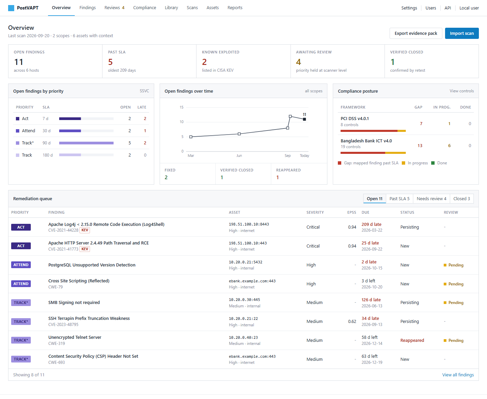
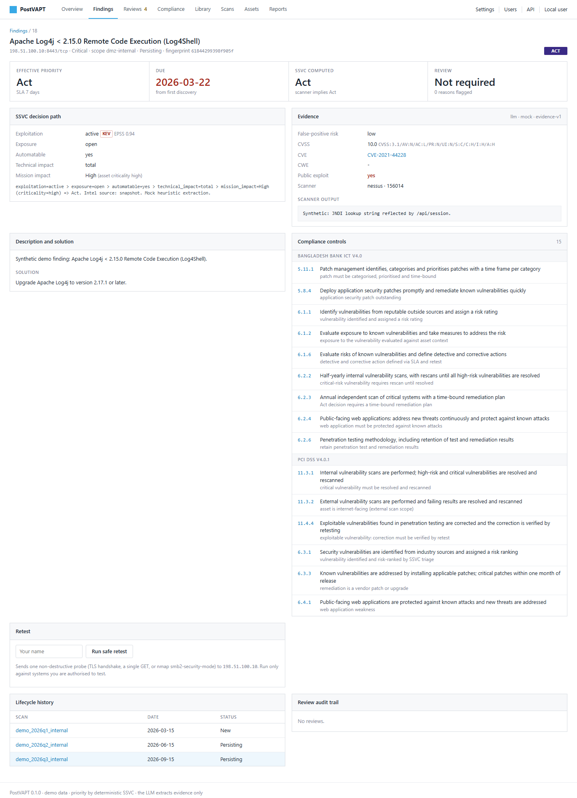
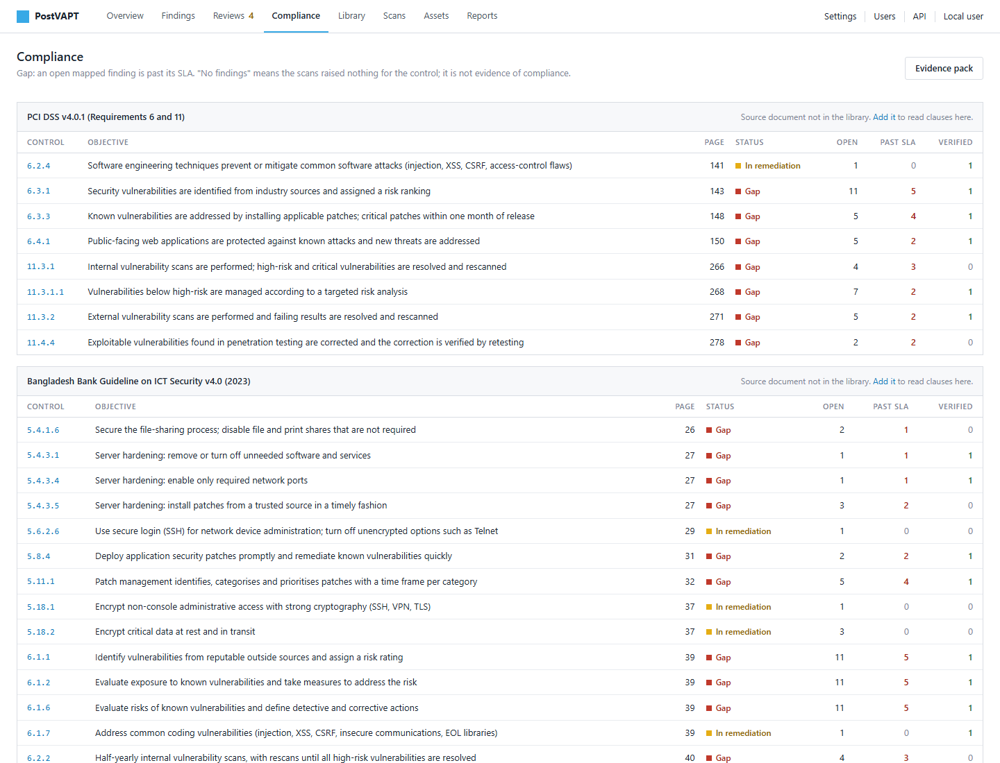

# PostVAPT

**From VAPT findings to verified fixes.**

PostVAPT reads the reports from your vulnerability scanners and penetration
tests, tells you **what to fix first and why**, checks that fixes really
worked, and produces **compliance evidence for PCI DSS v4.0 and the Bangladesh
Bank ICT Security Guideline v4.0**. It runs on your own computer or server:
your scan data never leaves your network.

## Start in 3 steps

| Step | What to do |
|---|---|
| **1. Get a free key** | Fill in the **[license key request form](https://docs.google.com/forms/d/e/1FAIpQLSd--0kYvYrB2WO6oxgv-_bCoI7tWw8U95I-gF2Qh9Isnc6e_Q/viewform)**. The key arrives by e-mail, usually within one business day. |
| **2. Download** | Open the **[latest release](https://github.com/mstnisa/postvapt/releases/latest)** and download the file for Windows, Linux or Docker. |
| **3. Start** | Windows: extract the zip and double-click **`Start PostVAPT.bat`**. Paste your key on the **License** page. |

Nothing else to install. No key yet? Run `postvapt.exe demo --serve` to explore
PostVAPT with sample data.

**New to PostVAPT? Read the [User Manual](USER_MANUAL.md)**: every screen and
every task explained step by step, with pictures, in plain English.

## Why teams use PostVAPT

- **Know what to fix first.** Hundreds of "critical" findings become a short,
  ordered list: Act, Attend, Track\*, Track, each with a deadline and a clear
  reason.
- **Real-world threat data.** Uses the CISA list of vulnerabilities attackers
  exploit today (KEV) and the EPSS attack-probability score.
- **Your business context counts.** Tell PostVAPT which systems are critical
  and which face the internet; priorities follow.
- **Track progress, scan after scan.** New, persisting, fixed and reappeared
  findings are found automatically, with SLA deadlines that never reset.
- **Proof, not promises.** Safe one-click retests confirm a fix before it is
  closed.
- **Audit-ready in one click.** An evidence pack mapped to PCI DSS v4.0 and
  Bangladesh Bank ICT Security Guideline v4.0 controls, with clause and page.
- **People stay in control.** Lowering a scanner's severity needs an analyst's
  approval, and every action is recorded.
- **Private by design.** Runs on-premise, works offline, and your scan data is
  never sent to the developer.

## Works with your scanners

Nessus / Tenable, OpenVAS / Greenbone, Burp Suite, OWASP ZAP, Nmap, Nuclei,
SARIF (Trivy, Grype, Semgrep, CodeQL and more) and CSV exports (Qualys, Rapid7,
Acunetix, Invicti and more). The format is detected automatically.

## See it in action

| | |
|---|---|
|  |  |
| **Every finding explained:** priority, deadline, evidence, solution, compliance impact and retest. | **Compliance posture:** gaps, work in progress and done, per PCI DSS and Bangladesh Bank control. |

More screens in the [User Manual](USER_MANUAL.md#5-a-tour-of-the-screens).

## Downloads

| Platform | File |
|---|---|
| Windows 10/11 (64-bit) | `postvapt-<version>-windows-x86_64.zip` |
| Linux (64-bit, glibc 2.41 or newer, e.g. Debian 13, Ubuntu 25.04) | `postvapt-<version>-linux-x86_64.zip` |
| Docker (any Linux server) | `postvapt-<version>-docker.tar.gz` |

Installation for each platform: [User Manual, section 4](USER_MANUAL.md#4-install-postvapt-in-5-minutes).

## Editions

| | Free edition | Paid edition |
|---|---|---|
| All features | yes | yes |
| Assets (distinct hosts) | up to 50 | unlimited |
| User accounts | up to 3 | unlimited |
| PostgreSQL database | - | yes |
| Price | free | coming soon |

Free edition. A paid edition will be offered later. Interested? Open an issue
titled **"Paid edition interest"**.

## Privacy

PostVAPT stores everything in a local database on your computer. The license
key is checked offline. Internet is only used for optional features you can
see and control: live threat data (CVE numbers only), optional AI assistance
(IP addresses removed), retests you start, and an anonymous usage signal that
is **off unless you turn it on**. Details: [User Manual, section 10](USER_MANUAL.md#10-your-data-privacy-and-security).

Run retests only against systems you are authorised to test.

## Support

Questions, problems or ideas: open an issue on the
**[Issues page](https://github.com/mstnisa/postvapt/issues)**. Please do not
post scan results, host names or other sensitive data.

## License

PostVAPT is proprietary software, provided under the
**[PostVAPT Evaluation License](LICENSE)**. You may install and use it for
internal evaluation and send feedback. Copying, redistribution, modification
and reverse engineering are not permitted. The source code is not published.
Open-source components keep their own licences: see
[THIRD_PARTY_NOTICES](THIRD_PARTY_NOTICES).

Copyright (c) 2026 Mst. Awalunnisa. All rights reserved.
