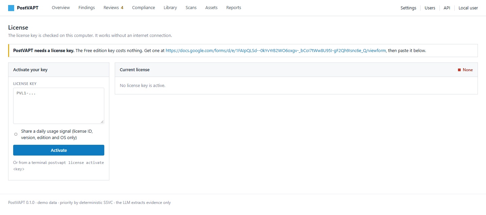
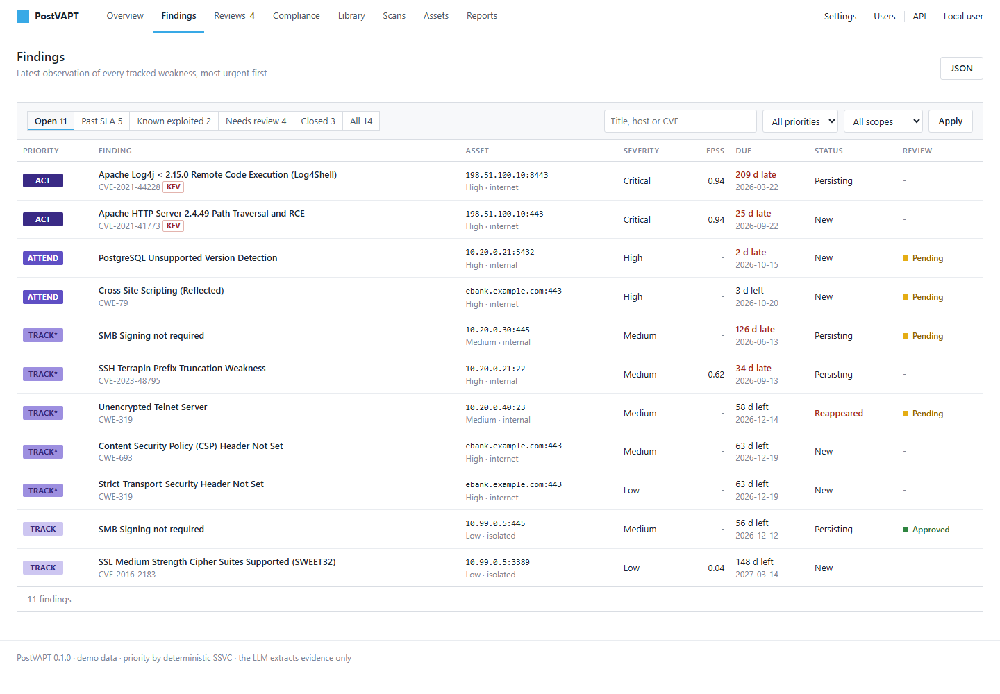
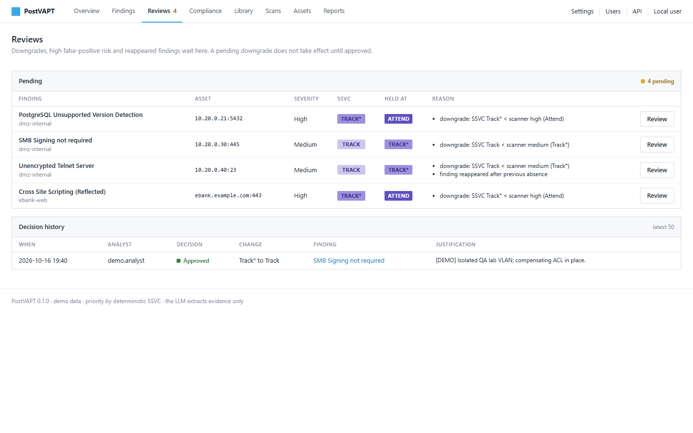
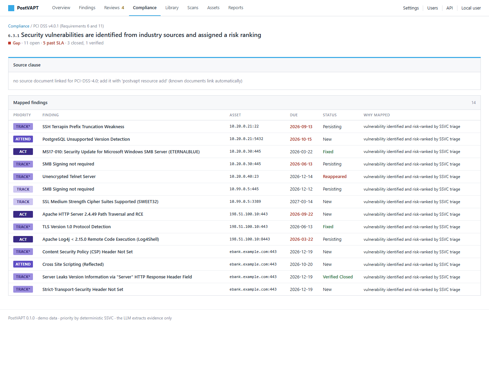
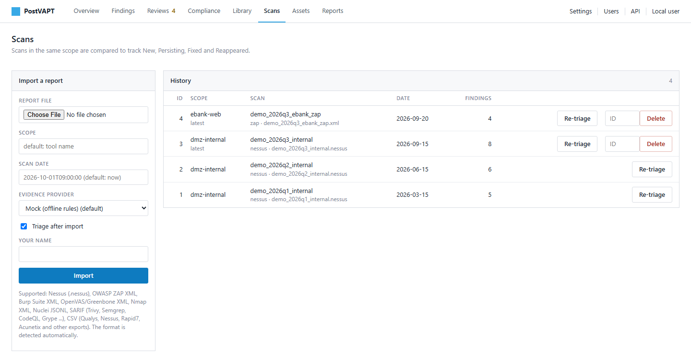
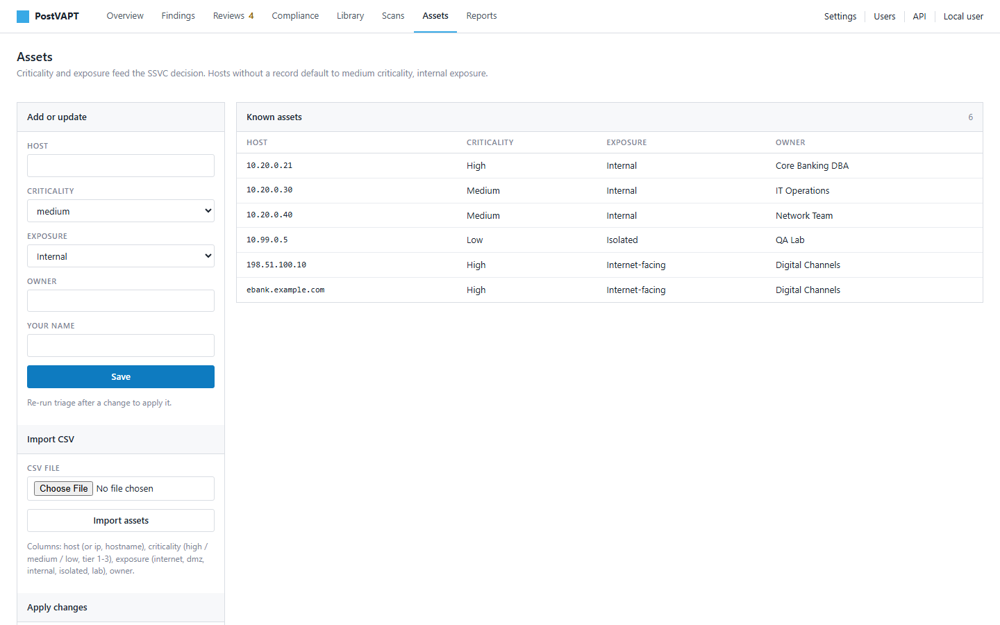
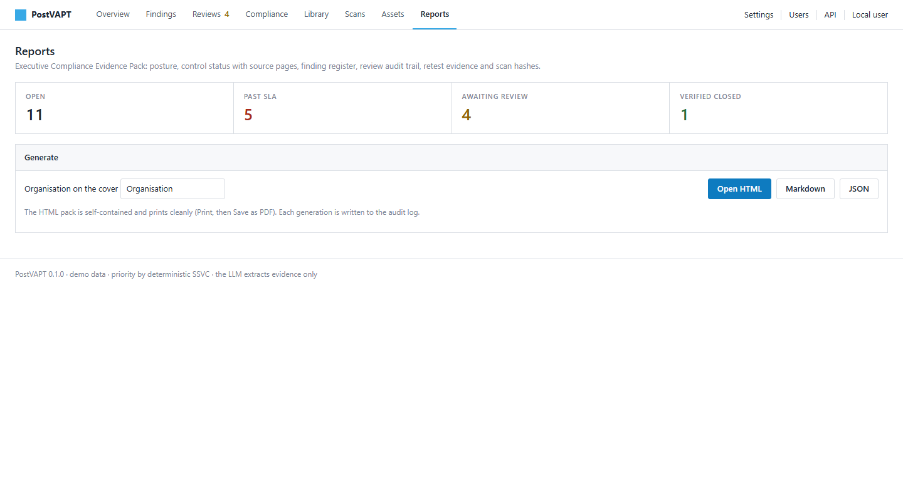
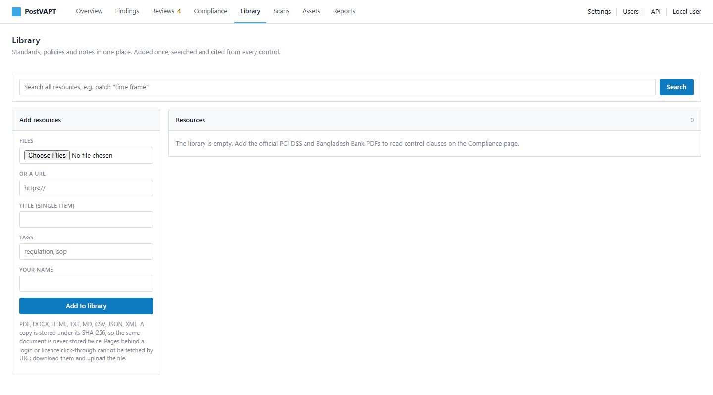
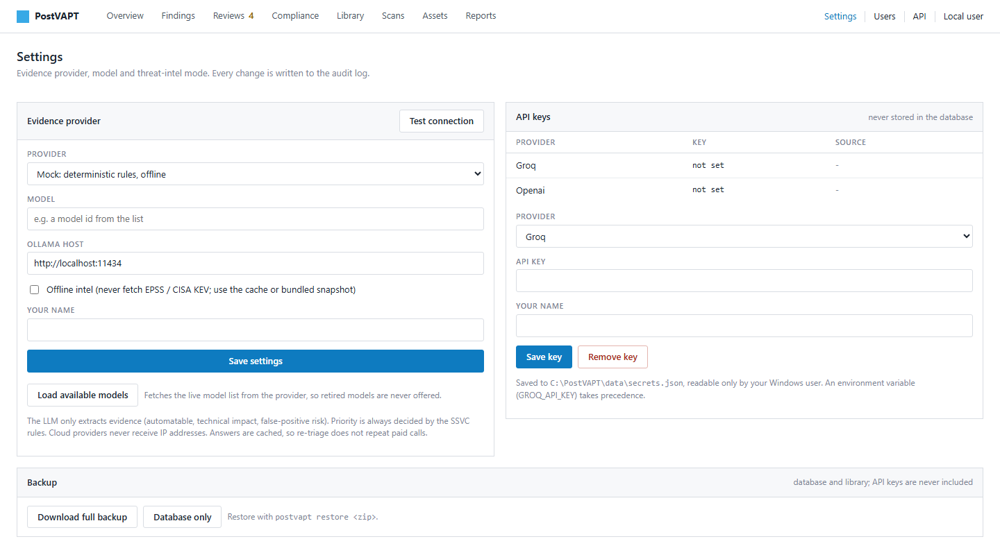
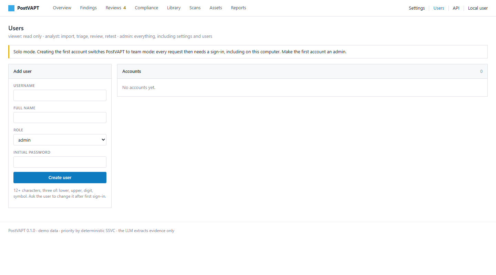

# PostVAPT User Manual

**Turn security scan reports into a clear, prioritised fix plan, and prove to
auditors that the work is done.**

This manual is written for everyone: security analysts, IT managers,
compliance officers and people who have never used a security tool before.
Every task is explained step by step, with pictures.

---

## Contents

1. [Why PostVAPT?](#1-why-postvapt)
2. [Words you will see](#2-words-you-will-see)
3. [What you need](#3-what-you-need)
4. [Install PostVAPT in 5 minutes](#4-install-postvapt-in-5-minutes)
5. [A tour of the screens](#5-a-tour-of-the-screens)
6. [Everyday tasks, step by step](#6-everyday-tasks-step-by-step)
7. [Working as a team](#7-working-as-a-team)
8. [Optional: AI assistance](#8-optional-ai-assistance)
9. [Optional: automation and the command line](#9-optional-automation-and-the-command-line)
10. [Your data, privacy and security](#10-your-data-privacy-and-security)
11. [Free and paid editions](#11-free-and-paid-editions)
12. [Questions and answers](#12-questions-and-answers)

---

## 1. Why PostVAPT?

A vulnerability scan or penetration test (VAPT) usually ends with a long report:
hundreds of findings, each marked "critical", "high" or "medium". Then the hard
questions start:

- *Which of these really need fixing this week?*
- *Did the team actually fix last quarter's findings, or did they come back?*
- *How do we show the auditor that we meet PCI DSS or Bangladesh Bank rules?*

Answering these by hand takes days of spreadsheet work, and mistakes are easy.

**PostVAPT does this work for you.**

| Without PostVAPT | With PostVAPT |
|---|---|
| Hundreds of "critical" items, no clear order | A short list of what to fix **first**, with the reason |
| Spreadsheets compared by hand after every scan | Every scan compared automatically: new, still open, fixed, came back |
| "Fixed" means someone said so | "Verified closed" means PostVAPT checked it safely |
| Days preparing audit evidence | An evidence pack mapped to PCI DSS and Bangladesh Bank controls in one click |
| Scan data uploaded to someone else's cloud | Everything stays on **your** computer or server |

### What makes PostVAPT different

- **Clear reasons, not a black box.** Every priority comes with the facts behind
  it: is the weakness being exploited right now, how likely is an attack, is the
  system on the internet, how important is it to your business?
- **Real-world threat data.** PostVAPT checks the CISA list of vulnerabilities
  that attackers are *already using*, and the EPSS score that predicts how
  likely an attack is in the next 30 days.
- **Built for regulated organisations.** Ready-made mapping to **PCI DSS v4.0**
  and the **Bangladesh Bank ICT Security Guideline v4.0**, with the clause and
  page number for every control.
- **Humans stay in charge.** When PostVAPT would lower a scanner's severity, a
  person must approve it first. Every decision is recorded.
- **Safe by design.** Retests never attack, never log in and never change
  anything on your systems.

---

## 2. Words you will see

| Word | Meaning in plain English |
|---|---|
| **Scan** / **report** | The file your scanner or tester gives you (for example a Nessus file). |
| **Finding** | One problem found by a scan, on one system. |
| **Asset** / **host** | A computer, server, website or device that was scanned. |
| **Scope** | A group of scans you want to compare over time, for example "internet-facing" or "internal network". |
| **Priority** | How urgently a finding should be fixed. PostVAPT uses four levels (below). |
| **SLA** | The deadline for fixing a finding, counted from the day it was first found. |
| **KEV** | "Known Exploited Vulnerabilities": a public list, kept by the US agency CISA, of weaknesses that attackers are using right now. |
| **EPSS** | A score from 0 to 1 that estimates how likely a weakness is to be attacked in the next 30 days. |
| **Retest** | A quick, safe check that a fix really worked. |
| **Control** | One rule in a security standard, for example "PCI DSS 6.3.3: install critical patches within one month". |

### The four priority levels

| Priority | What it means | Fix within |
|---|---|---|
| **Act** | Fix now. A serious, likely attack on an important system. | 7 days |
| **Attend** | Fix soon, in the next planned change. | 30 days |
| **Track\*** | Watch closely and fix in normal maintenance. | 90 days |
| **Track** | Low urgency. Fix when convenient. | 180 days |

### What happens to a finding over time

| Status | Meaning |
|---|---|
| **New** | Seen for the first time in this scope. |
| **Persisting** | Still there in the latest scan. |
| **Fixed** | Gone in the latest scan of the same systems. |
| **Verified closed** | PostVAPT retested it and confirmed the fix. |
| **Reappeared** | It was fixed or closed, but it came back. PostVAPT flags this for review. |

---

## 3. What you need

- **Windows 10 or 11** (64-bit), **or** a 64-bit **Linux** computer (Ubuntu 24.04+,
  Debian 13+, Fedora 39+), **or** any
  server with **Docker**.
- About 300 MB of free disk space.
- A modern web browser (Chrome, Edge or Firefox).
- **No** Python, database or other software to install.
- **No** internet connection is required to run PostVAPT. With internet,
  PostVAPT can download the latest threat data.

---

## 4. Install PostVAPT in 5 minutes

### Step 1: Request your free license key

1. Open the **[license key request form](https://docs.google.com/forms/d/e/1FAIpQLSd--0kYvYrB2WO6oxgv-_bCoI7tWw8U95I-gF2Qh9Isnc6e_Q/viewform)**.
2. Enter your name, work e-mail, organisation, sector and country.
3. Press **Submit**.

Your key arrives by e-mail, usually within one business day. It is a long line
of text that starts with `PVL1-`. While you wait, you can already try the demo
(Step 4).

### Step 2: Download

1. Open the **[Releases page](https://github.com/mstnisa/postvapt/releases/latest)**.
2. Under **Assets**, click the file for your computer:
   - Windows: `postvapt-<version>-windows-x86_64.zip`
   - Linux: `postvapt-<version>-linux-x86_64.zip` (Ubuntu 24.04 or newer, Debian 13,
     Fedora 39 or newer; on older Linux such as Ubuntu 22.04, use Docker)
   - Docker: `postvapt-<version>-docker.tar.gz`

### Step 3: Install and start

#### On Windows

1. Right-click the downloaded zip file and choose **Extract All...**
2. Choose a folder, for example `C:\PostVAPT`, and press **Extract**.
3. Open the folder and double-click **`Start PostVAPT.bat`**.
4. If Windows shows "Windows protected your PC", click **More info**, then
   **Run anyway**. This message appears for new programs that are not yet
   widely downloaded.
5. A black window opens and PostVAPT starts. Your browser opens the dashboard at
   **http://127.0.0.1:8000**.

Keep the black window open while you use PostVAPT. Close it to stop PostVAPT.
Your data is saved automatically in `%APPDATA%\PostVAPT`.

#### On Linux

```bash
unzip postvapt-<version>-linux-x86_64.zip -d ~/postvapt
cd ~/postvapt/postvapt
./postvapt-bin serve --open
```

#### With Docker

```bash
docker load -i postvapt-<version>-docker.tar.gz
docker run --rm -v postvapt-data:/data postvapt:<version> license activate <your-key>
docker run --rm -it -v postvapt-data:/data postvapt:<version> user add admin --role admin
docker run -d --name postvapt -p 8000:8000 -v postvapt-data:/data postvapt:<version>
```

Then open `http://<server-address>:8000` and sign in as `admin`.

### Step 4: Try the demo (no key needed)

The demo loads realistic, made-up scan data so you can explore every screen
safely. On Windows, open a terminal in the PostVAPT folder (click the address
bar of the folder, type `cmd` and press Enter), then run:

```
postvapt.exe demo --serve
```

Open **http://127.0.0.1:8000** in your browser. Press `Ctrl + C` in the black
window to stop the demo. All pictures in this manual come from the demo.

### Step 5: Activate your key

1. In PostVAPT, open the **License** page (top right).
2. Paste your key into the **License key** box.
3. Press **Activate**.



That's it. The key is checked on your computer and works without internet.

---

## 5. A tour of the screens

The menu at the top takes you to every screen.

### Overview: your security at a glance


At the top, five numbers tell the story of your security today:

- **Open findings**: problems still waiting to be fixed.
- **Past SLA**: problems that missed their deadline. This should be zero.
- **Known exploited**: open problems that attackers are using right now (KEV).
  Fix these first.
- **Awaiting review**: decisions that need a person's approval.
- **Verified closed**: fixes that PostVAPT confirmed with a retest.

Below them:

- **Open findings by priority**: how many Act, Attend, Track\* and Track items
  you have, and how many are late.
- **Open findings over time**: is your security getting better or worse, scan
  after scan?
- **Compliance posture**: how many PCI DSS and Bangladesh Bank controls have a
  gap, are in progress, or are done.
- **Remediation queue**: the most urgent findings first. Use the tabs to see
  **Past SLA**, **Needs review** or **Closed** items.

Buttons: **Import scan** (add a new report) and **Export evidence pack**
(create the compliance report).

### Findings: the full list



Every finding from every scan, most urgent first. You can:

- **Search** by name, CVE number or host.
- **Filter** by priority, scope or status (open, late, needs review, closed).
- Click any finding to open its full details.

### Finding details: everything about one problem


- **Effective priority** and **Due date**: what to do and by when.
- **SSVC decision path**: the facts behind the priority, in one line you can
  show to your manager or auditor.
- **Evidence**: the scanner's output, CVE, CVSS score and whether a public
  exploit exists.
- **Description and solution**: what is wrong and how to fix it.
- **Compliance controls**: which PCI DSS and Bangladesh Bank rules this finding
  affects, and why.
- **Retest**: check the fix safely with one click.
- **Lifecycle history**: when the finding appeared, persisted or was fixed.
- **Review audit trail**: who approved or rejected decisions, and why.

### Reviews: decisions that need a person



PostVAPT never quietly lowers a scanner's severity. When its analysis says a
"critical" is really less urgent, the finding waits here until an analyst
approves or rejects the change, with a written reason. Findings that came back
after a fix, or that might be false alarms, also appear here.

### Compliance: are we meeting the rules?


Each control from **PCI DSS v4.0** and the **Bangladesh Bank ICT Security
Guideline v4.0** gets a status:

| Status | Meaning |
|---|---|
| **Gap** | A related finding is past its deadline. Action needed. |
| **In remediation** | Related findings are open but still within their deadline. |
| **Remediated** | All related findings are fixed or verified closed. |
| **No findings** | The scans found nothing related to this control. |

Click a control to see its official text, the source page, and every finding
mapped to it:



### Scans: import and history



Import a new report and see every scan you have imported. Each row shows the
scope, date and number of findings. Use **Re-triage** to recalculate priorities
(for example after you update your asset list), or **Delete** to remove a scan
imported by mistake.

### Assets: tell PostVAPT what matters



The same weakness is more urgent on your payment server than on a test laptop.
Here you tell PostVAPT, for each host:

- **Criticality**: how important it is to your business (high, medium, low).
- **Exposure**: who can reach it (open = internet, controlled = internal
  network, small = isolated).
- **Owner**: the person or team responsible.

You can add hosts one by one or import a spreadsheet (CSV).

### Reports: the evidence pack



Enter your organisation's name and download the **Executive Compliance
Evidence Pack** as HTML (ready to print or save as PDF), Markdown or JSON. It
contains key figures, control status with source pages, the full finding
register, review decisions, retest evidence and the list of scans with file
fingerprints.

### Library: your reference documents



Keep your standards, policies and guidelines in one searchable place. Add PDF
files, whole folders or web links, then search across them with page numbers.
Link a document to a framework so control pages show the exact clause.

### Settings, Users and License



- **Settings** (admins): optional AI assistance, offline mode for threat data,
  and **Backup** downloads.
- **Users** (admins): create accounts and choose roles.
- **License**: activate or view your license key.



---

## 6. Everyday tasks, step by step

### Task 1: Describe your important systems (once, then when things change)

1. Open **Assets**.
2. For each important host, enter the host name or IP address, choose its
   **criticality** and **exposure**, and add an **owner**.
3. Press **Save**.

**Tip:** for many hosts, prepare a spreadsheet with the columns `host`,
`criticality`, `exposure` and `owner`, save it as CSV, and use **Import CSV**.

### Task 2: Import a scan report

1. Export the report from your scanner. Supported formats:

   | Scanner | Export to choose |
   |---|---|
   | Nessus / Tenable | `.nessus` file or CSV |
   | OpenVAS / Greenbone | XML report |
   | Burp Suite | Issues XML export |
   | OWASP ZAP | Traditional XML report |
   | Nmap | XML output (`-oX`) |
   | Nuclei | JSON or JSONL output |
   | Trivy, Grype, Semgrep, CodeQL and others | SARIF |
   | Qualys, Rapid7, Acunetix, Invicti and others | CSV |

2. In PostVAPT, open **Scans** (or press **Import scan** on the Overview).
3. Press **Choose file** and select the report.
4. Type a **Scope**, for example `internet` or `internal`. Use the same scope
   every time you scan the same group of systems, so PostVAPT can compare them.
5. Leave **Triage after import** ticked.
6. Press **Import**.

In a few seconds, the Overview shows your new priorities.

### Task 3: Decide what to fix this week

1. Open **Overview**.
2. Look at the **Remediation queue**. Start from the top: **Act** items and
   anything marked **KEV**.
3. Open a finding, read **Description and solution**, and send it to the owner
   of the system.
4. Watch the **Past SLA** number. Your goal is zero.

### Task 4: Approve or reject a priority change

1. Open **Reviews**. Pending items are listed at the top.
2. Click **Review** next to a finding and read the reasons.
3. Choose **Approve** to accept PostVAPT's priority, or **Reject** to keep the
   scanner's higher level.
4. Write a short comment explaining your decision. It is required, and it is
   kept in the audit trail.

### Task 5: Confirm a fix with a safe retest

1. Open the finding that the team says is fixed.
2. Under **Retest**, type your name and press **Run safe retest**.
3. The result is one of:
   - **Passed**: the problem is gone. The finding becomes **Verified closed**.
   - **Failed**: the problem is still there.
   - **Inconclusive**: PostVAPT could not check this type of finding
     automatically. Check it manually.

PostVAPT can retest old TLS versions, missing HTTP security headers, software
versions shown by web servers and other services, and SMB signing (SMB checks
need the free Nmap tool installed). The checks
are gentle: no attacks, no logins, no changes.

**Only retest systems you are authorised to test.**

### Task 6: Compare this quarter with last quarter

Just import the new scan into the **same scope** (Task 2). PostVAPT compares it
with the previous scan automatically:

- Findings that are gone become **Fixed**.
- Findings that are still there become **Persisting**, and keep their original
  deadline.
- Findings that come back become **Reappeared** and go to **Reviews**.

The **Open findings over time** chart on the Overview shows your progress.

### Task 7: Prepare for an audit

1. Open **Reports**.
2. Enter your organisation's name.
3. Download the **HTML** evidence pack and open it in your browser.
4. Print it, or use your browser's **Print > Save as PDF**.

Give the auditor the pack together with the **Compliance** page.

### Task 8: Fix a mistake

- **Imported the wrong file?** Open **Scans**, type the scan's ID in the box
  next to **Delete** and press **Delete**. Only the latest scan of a scope can
  be deleted, so history stays consistent.
- **Changed criticality or exposure?** Open **Scans** and press **Re-triage**
  on the latest scan, so priorities use the new information.

### Task 9: Back up your data

1. Open **Settings**.
2. Under **Backup**, press **Download full backup**.
3. Keep the zip file somewhere safe.

To restore, run `postvapt restore <backup-file.zip>`. API keys are never
included in backups.

---

## 7. Working as a team

Out of the box, PostVAPT runs in **solo mode**: no passwords, and only the
computer it runs on can open it. To share it with colleagues:

1. Open **Users** and create the first account with the **admin** role. From
   now on, everyone signs in.
2. Create an account for each colleague and choose a role:

   | Role | Can |
   |---|---|
   | **Viewer** | See every page and download reports. |
   | **Analyst** | Everything a viewer can, plus import scans, triage, review, retest and edit assets and the library. |
   | **Admin** | Everything, plus settings, users and the license. |

3. Start PostVAPT on the network (ask your IT team to use HTTPS):

   ```
   postvapt serve --host 0.0.0.0 --port 8443 --ssl-certfile cert.pem --ssl-keyfile key.pem
   ```

Security built in: passwords need at least 12 characters, accounts lock for 15
minutes after 5 wrong passwords, and sessions end after 30 minutes of
inactivity. Every action is recorded under the person who did it.

The Free edition includes up to 3 user accounts.

---

## 8. Optional: AI assistance

PostVAPT works fully without AI. If you like, an AI model can read each finding
and pull out extra evidence, such as whether an attack can be automated or
whether the finding might be a false alarm.

- The AI **never** decides priority. It only adds evidence; the priority rules
  stay the same.
- IP addresses are removed before anything is sent to a cloud AI service.
- Answers are saved, so the same finding is not sent twice.

To turn it on:

1. Open **Settings**.
2. Under **API keys**, choose a provider (for example **Groq**), paste your API
   key from that provider's website and press **Save key**.
3. Under **Evidence provider**, choose the same provider, press
   **Load available models**, pick a model and press **Save settings**.
4. Press **Test connection** to check that it works.

For a fully private setup, you can use a local model with **Ollama** instead.

---

## 9. Optional: automation and the command line

Everything on the screens can also be done from a terminal, which is useful for
scheduled jobs:

| Command | What it does |
|---|---|
| `postvapt ingest report.nessus --scope internal` | Import a scan |
| `postvapt triage` | Prioritise the latest scan |
| `postvapt findings` | List findings |
| `postvapt review list` | Show decisions waiting for review |
| `postvapt retest <finding-id>` | Run a safe retest |
| `postvapt report --organisation "My Bank"` | Create the evidence pack |
| `postvapt asset-import assets.csv` | Import asset context |
| `postvapt backup` | Create a backup |
| `postvapt license status` | Show your license |
| `postvapt --help` | List every command |

On Windows, use `postvapt.exe`; on Linux, `./postvapt-bin`.

**Connect other tools:** PostVAPT has a JSON API (see **API** in the top menu)
for tools such as n8n or your CI pipeline. Create a personal API token on your
**Account** page and send it as `Authorization: Bearer <token>`.

---

## 10. Your data, privacy and security

- **Your data stays with you.** Scan results, findings, host names and IP
  addresses are stored only on the computer or server where PostVAPT runs.
- **Works offline.** The license is checked on your computer. Threat data can
  be loaded from a built-in snapshot when there is no internet.
- **Optional internet use, always visible:**

  | Feature | Goes to | What is sent |
  |---|---|---|
  | Live threat data | api.first.org, www.cisa.gov | CVE numbers only |
  | AI assistance (off by default) | the AI provider you choose | finding text, IP addresses removed |
  | Retest (you start it) | the system being retested | a gentle check |
  | Usage signal (only if you turn it on) | the PostVAPT developer | license ID, version, edition, operating system |

- **Audit trail.** Imports, reviews, retests, setting changes and sign-ins are
  recorded and cannot be edited.

---

## 11. Free and paid editions

| | Free edition | Paid edition |
|---|---|---|
| All features in this manual | yes | yes |
| Assets (distinct hosts) | up to 50 | unlimited |
| User accounts | up to 3 | unlimited |
| PostgreSQL database for large teams | - | yes |
| Direct support from the developer | - | yes |
| Price | free | coming soon |

**Free edition. A paid edition will be offered later.** Free keys already issued
will keep working.

**Need more than 50 assets, more users or support for your organisation?**
Open an issue titled **"Paid edition interest"** on the
[Issues page](https://github.com/mstnisa/postvapt/issues).


---

## 12. Questions and answers

**Do I need to be a security expert?**
No. Import your scanner's report and PostVAPT tells you what to fix first and
why. This manual explains every screen.

**Does PostVAPT scan my network?**
No. It reads the reports from the scanners you already use. The only network
activity it starts itself is the optional, gentle retest.

**Is my data sent to the developer?**
No. Your scan data never leaves your computer. The optional usage signal sends
only your license ID, version, edition and operating system, and only if you
turn it on.

**The dashboard does not open.**
Make sure the black PostVAPT window is still open, then go to
http://127.0.0.1:8000 yourself. If another program already uses port 8000, run
`postvapt.exe serve --port 8080 --open`.

**"PostVAPT needs a license key".**
Request a free key with the form, then paste it on the **License** page. The
demo (`postvapt.exe demo --serve`) works without a key.

**"The free edition covers up to 50 assets".**
The Free edition supports 50 distinct hosts. Delete old scans you no longer
need, or tell us you are interested in the paid edition.

**A retest says "inconclusive".**
PostVAPT cannot check that type of finding automatically, or the system did not
answer. Check the fix manually.

**Can I move PostVAPT to another computer?**
Yes. Download a backup on the old computer (Task 9), install PostVAPT on the new
one, run `postvapt restore <backup-file.zip>` and activate your key.

**Where do I get help?**
Open an issue on the [Issues page](https://github.com/mstnisa/postvapt/issues).
Please do not post scan results, host names or other sensitive data.

---

*PostVAPT is proprietary software provided under the
[PostVAPT Evaluation License](LICENSE). Copyright (c) 2026 Mst. Awalunnisa.*
